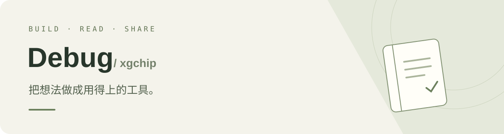
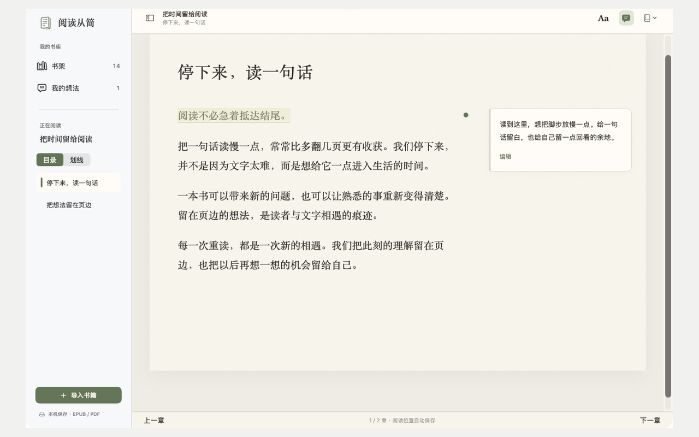

**做实用的软件，也把代码分享出来。**

[正在做的项目](#-阅读从简-reading-simple) · [所有仓库](https://github.com/xgchip?tab=repositories) · [反馈与交流](https://github.com/xgchip/reading-simple/issues)

 

## 📖 阅读从简 · Reading Simple

**让原句和想法待在一起。**

一款免费开源的原生 Mac 阅读器。读 EPUB 和 PDF，划下值得留下的句子，记下当时的想法；需要时，从笔记回到原文。

**[查看源码 →](https://github.com/xgchip/reading-simple)**　 ·　 **[下载安装包 ↓](https://github.com/xgchip/reading-simple/releases/tag/v1.0.0)**　 ·　 **[访问官网 ↗](https://xgchip.github.io/reading-simple/)**

 

| 阅读 | 记录 | 留存 |
| :--- | :--- | :--- |
| EPUB / PDF 双格式 | 划线与页边想法 | Markdown 笔记导出 |
| 素白、暖纸、深色主题 | 跨书搜索并返回原文 | 书库与笔记本地保存 |

`Swift` · `SwiftUI` · `SwiftData` · `WebKit` · `PDFKit` · `GPL-3.0`

界面中的书籍与笔记为原创演示内容。当前下载为 Apple Silicon 公开测试版，未经 Apple 公证，macOS 可能阻止首次打开；请先阅读发布页的安装说明。

 

---

### 一起把它做得更好

遇到问题，或有想实现的小功能，欢迎在 [Issues](https://github.com/xgchip/reading-simple/issues) 留下反馈，也欢迎提交 Pull Request。

**从一个小需求出发，把工具慢慢做好。**
