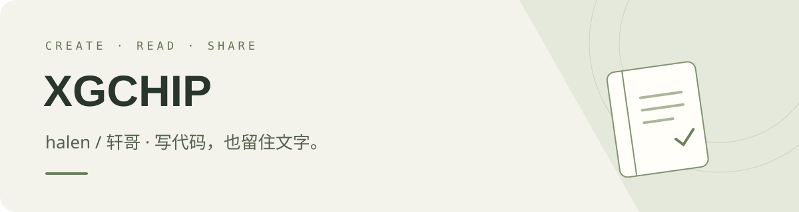
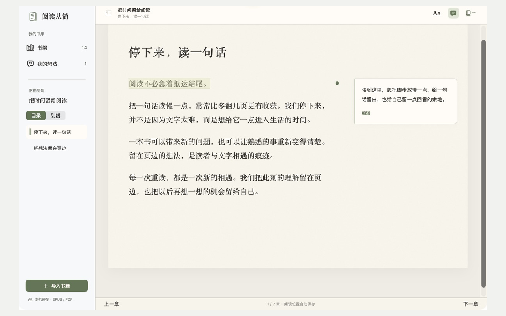

### 你好，我是 halen，也可以叫我轩哥。

从自己的使用需求出发，做一些能用得上、也愿意一直打磨的东西。  
目前，我在维护博客主题、阅读工具与桌面语音伙伴：让技术资料更好查，让文章更好读，也让小智来到电脑上。

[我的作品](#projects) · [所有仓库](https://github.com/xgchip?tab=repositories)

 

## 我的作品

| 🖋 MoluRead | 📖 阅读从简 · Reading Simple | ⚡ elecnotes |
| :--- | :--- | :--- |
| **让博客回到文字与阅读。** | **让原句和想法待在一起。** | **让技术文章成为方便查阅的资料。** |
| 面向中文博客阅读的 Typecho 主题，基于 HarmonyHues 二次开发。 | 免费开源的原生 Mac EPUB / PDF 阅读器。 | 基于 MoluRead 继续开发的电子工程内容主题。 |
| 阅读布局、可视化导航、动态标签云，以及浅色与深色模式。 | 划线与想法、跨书搜索与原文回跳、Markdown 笔记导出。 | 资料导航与经典卡片双首页、专题目录、工具入口，以及简洁的出版物式排版。 |
| `Typecho` · `PHP` · `CSS` · `JavaScript` | `Swift` · `SwiftUI` · `PDFKit` · `WebKit` | `Typecho` · `PHP` · `CSS` · `JavaScript` |
| [查看主题源码 →](https://github.com/xgchip/MoluRead) | [查看源码 →](https://github.com/xgchip/reading-simple) · [下载安装包 ↓](https://github.com/xgchip/reading-simple/releases/tag/v1.0.0) · [官网 ↗](https://xgchip.github.io/reading-simple/) | [在线演示 ↗](https://www.ee-nav.com/) |
| CC BY-NC-SA 4.0，保留上游署名及非商业使用条件。 | GPL-3.0，自由使用与修改，分发遵循许可证。 | 开发试用中，源码暂未公开。 |

看看「阅读从简」的实际界面

 

书籍与笔记为原创演示内容。当前安装包为 Apple Silicon 公开测试版，未经 Apple 公证；安装前请阅读发布页说明。

### 小智电脑版

**让小智来到电脑上，像打电话一样聊天。**

基于 Tauri、Vue 和 Rust 的开源桌面客户端，连接 [xiaozhi.me](https://xiaozhi.me) 后台。支持连续语音通话、开口打断、可调停顿自动发送，也可以一键切换为桌面宠物。

每位用户自行注册小智账号并配对，不附带开发者的设备绑定。当前提供 Windows 版本，采用 MIT 许可证。感谢虾哥的 [xiaozhi-esp32](https://github.com/78/xiaozhi-esp32) 开源项目；界面图片会在下一版 UI 优化后补充。

[查看源码 →](https://github.com/xgchip/xiaozhidesk) · [下载安装包 ↓](https://github.com/xgchip/xiaozhidesk/releases)

 

## 我想做的事

- **把体验做好。** 从阅读布局到记录想法，让日常使用更顺手。
- **把作品分享出来。** 公开实现和改进过程，让有相同需求的人也能用上。
- **把小事慢慢做好。** 从真实反馈中改进，持续维护自己的作品。

---

欢迎逛逛我的仓库。如果你正在使用 MoluRead、阅读从简、elecnotes 或小智电脑版，欢迎留下建议，也欢迎参与改进。公开项目的问题可提交至 [MoluRead Issues](https://github.com/xgchip/MoluRead/issues) 、[阅读从简 Issues](https://github.com/xgchip/reading-simple/issues) 或 [小智电脑版 Issues](https://github.com/xgchip/xiaozhidesk/issues)。

**XGCHIP · halen / 轩哥**
